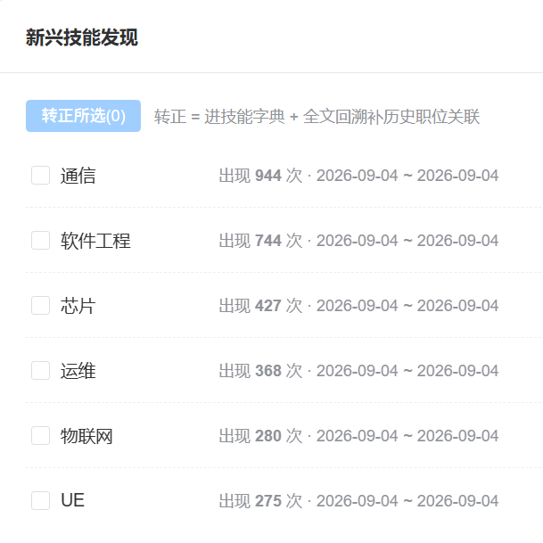
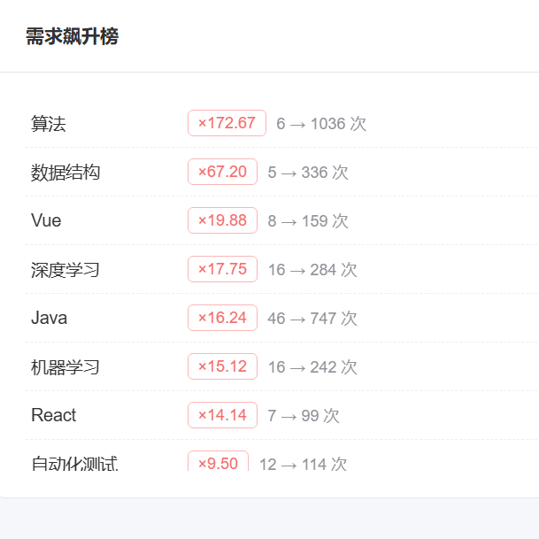

# JobHunter —— 基于数据驱动的岗位能力动态演化与分析系统

## 作品介绍文档

---

## 摘要

JobHunter 是一个面向新一代信息技术领域的岗位能力分析系统,想解决三个实际问题:

1. **画像跟不上市场**:岗位能力画像一般靠静态字典和人工调研,市场上已经火起来的新技能(比如 AIGC 相关)迟迟进不了分析体系,画像总是慢半拍;
2. **招聘数据本身不干净**:平台上的岗位说明书(JD)互相抄、技能要求随便堆,直接拿这种数据建能力图谱,结论会失真;
3. **大模型会编**:让大模型直接生成岗位画像,看着专业,但可能写出根本不存在的技能要求,又缺少真实数据来核对。

针对这三点,系统以 10,000 条真实爬取的岗位数据和 110 项技能字典为数据基础,用 MySQL、Elasticsearch、ChromaDB、Neo4j 四个库分别承担业务存储、全文检索、向量召回和知识图谱,功能上串起"数据采集 → 新岗位发现与定义 → 岗位能力动态更新 → 技能粒度全景图谱 → 简历解析 → 人岗匹配与差距分析"整条链路。

系统主要做了四件事:①**新技能自动发现**——字典里没有的技能词会进候选榜,管理员确认转正后自动回填历史数据,新技能进入分析体系不用改代码;②**用 LLM 反向核验平台标签**——随机抽 100 条真实 JD 逐标签核对,实测出 8.1% 的平台标签噪声,为数据清洗提供了量化依据;③**防模型编造的六道防线**——证据约束、字典校验、别名判断、人工修正、失败降级,每一处模型输出都有确定性机制拦一道;④**AI 求职顾问**——1 个 Master Agent 带 7 个领域子 Agent,覆盖岗位分析、差距分析、学习规划、趋势预测、报告生成、岗位对比、简历岗位匹配,岗位检索直接查主库真实数据,用户简历画像自动带进对话。

核心指标全部达到赛题要求:**JD 解析准确率 91.9%**(100 条真实 JD 核验)、**简历提取准确率 96.0%**(13 份真实简历人工标注)、**人岗匹配 Precision@5 = 90.8%**(Top1 相关率 100%,MRR 1.00)。系统用 Docker 六容器部署,解压后两步初始化即可运行。

**关键词**:岗位能力图谱;新兴技能发现;人岗匹配;大模型;知识图谱;交叉验证;幻觉防控

---

## 目录

- 一、项目概述
  - 1.1 行业背景与三大痛点
  - 1.2 项目定位与全流程闭环
  - 1.3 岗位选择范围与可迁移性
  - 1.4 主要成果一览
- 二、系统总体架构
  - 2.1 四层服务架构
  - 2.2 四库协同设计
  - 2.3 一键同步管道与幂等设计
  - 2.4 技术栈
- 三、核心功能实现
  - 3.1 多源数据采集与一键入库
  - 3.2 新岗位发现与定义(核心功能一)
  - 3.3 既有岗位能力动态更新(核心功能二)
  - 3.4 新一代信息技术岗位全景图谱(核心功能三)
  - 3.5 简历解析与精准人岗匹配(核心功能四)
    - 3.5.1 简历智能解析
    - 3.5.2 三段式混合岗位推荐
    - 3.5.3 AI 求职顾问:差距分析与学习路径
  - 3.6 新兴技能发现闭环(特色机制)
  - 3.7 数据大盘与求职全流程
- 四、技术创新
  - 4.1 多源异构数据清洗与交叉验证机制
  - 4.2 能力"幻觉"防控体系(六道防线)
  - 4.3 大模型 + 知识图谱 + RAG 的融合
  - 4.4 工程可靠性设计
- 五、评测结果
- 六、部署与运行
- 七、项目结构
- 八、总结

---

## 一、项目概述

### 1.1 行业背景与三大痛点

数字经济背景下,新一代信息技术领域(人工智能、大数据、智能系统、物联网等)的岗位体系变化很快,但传统的岗位分析手段跟不上,主要有三个问题:

1. **数据滞后**:岗位能力画像依赖静态字典和人工调研,市场上已经爆发的新技能(如 AIGC 相关技能)迟迟进不了分析体系,画像总是落后于市场;
2. **数据有噪声**:招聘平台的岗位说明书(JD)普遍存在抄袭和技能堆砌——同一份 JD 被反复复制,技能要求越写越多,直接据此构建能力图谱会得到失真的结论;
3. **模型会编造**:大模型直接生成的岗位画像看似专业,但可能臆造并不存在的技能要求,缺少真实数据的核验。

### 1.2 项目定位与全流程闭环

JobHunter 以真实招聘数据为基础,把各个环节串成一条链路:

```
多源数据采集 → 新岗位发现与定义 + 既有岗位能力动态更新
            → 能力图谱动态演化 → 简历智能解析
            → 精准人岗匹配与差距分析 → 学习路径规划
```

我们的基本想法是:岗位能力画像不应该是一次性做完就放在那的静态结果,而应该由真实数据驱动、随市场持续更新,并且每一步都能查证、都能人工干预。

### 1.3 岗位选择范围与可迁移性

按赛题"立足数字经济、瞄准新一代信息技术"的要求,系统当前以 10,000 条真实岗位为数据基础,覆盖**数据分析、AI 算法(机器学习/深度学习/大模型)、大数据、软件开发(Java/Python/前后端)、测试**等方向;岗位方向由可配置的正则规则划分(当前 23 个方向)。要扩展新方向(如物联网、智能硬件),只需添加规则并更换或追加爬虫数据源,发现、演化、匹配各环节都能直接复用。

### 1.4 主要成果一览

| 维度 | 成果 |
|---|---|
| 数据基础 | 10,000 条真实爬取岗位 + 110 项技能字典(69 项含别名),四库分库存储 |
| 核心功能 | 赛题四大核心功能逐条落地(新岗位发现/能力动态更新/技能粒度图谱/匹配与差距分析) |
| 核心指标 | JD 解析 91.9%(100 条)、简历提取 96.0%(13 份真实简历)、匹配 P@5 90.8%(人工标注) |
| 创新机制 | 新兴技能自动发现、LLM 交叉验证(实测 8.1% 平台噪声)、六道幻觉防线 |
| 工程交付 | Docker 六容器一键部署,解压后两步初始化即可运行 |

---

## 二、系统总体架构

### 2.1 四层服务架构

```
┌─────────────────────────────────────────────────────┐
│  前端展示层  Vue 3 + Element Plus + ECharts           │
│  数据大盘 / 知识图谱 / 岗位推荐 / AI求职顾问 / 数据管理   │
├─────────────────────────────────────────────────────┤
│  业务后端层  FastAPI(Python 3.12,全异步)              │
│  推荐引擎 / 统计分析 / 新岗位发现 / 新兴技能闭环 / 图谱服务 │
├─────────────────────────────────────────────────────┤
│  大模型引擎层(独立服务, 端口 8001)                      │
│  简历解析引擎 / 多智能体求职顾问 / 6 家模型容灾路由        │
├─────────────────────────────────────────────────────┤
│  数据存储层  四库协同                                  │
│  MySQL(主库) + Elasticsearch(全文检索)               │
│  + ChromaDB(向量库) + Neo4j(知识图谱)                │
└─────────────────────────────────────────────────────┘
```

业务后端与大模型引擎均为独立 FastAPI 服务,Nginx 统一接入:普通业务请求转发主后端(8000),AI 顾问请求定向 LLM 引擎(8001)。流量和故障都做了隔离,引擎异常不影响主站。

### 2.2 四库协同设计

同一份岗位数据同时写入四种存储,各取所长:

| 存储 | 职责 | 支撑的功能 |
|---|---|---|
| **MySQL 8.0** | 业务主库,事务与关联查询 | 岗位/公司/技能字典/简历/推荐流水/收藏投递 + LLM 引擎 9 张运行时表 |
| **Elasticsearch 8.11** | IK 中文分词全文检索 | 职位搜索、新兴技能转正后的历史 JD 全文回溯 |
| **ChromaDB** | 向量语义检索 | 岗位向量召回("语义相近但技能词不重叠"的岗位) |
| **Neo4j 5.x** | 知识图谱 | 岗位方向全景图谱(技能点粒度) |

其中 MySQL 的表结构覆盖系统全链路:业务表之外,大模型引擎的 9 张运行时表(聊天会话/消息/Agent 执行追踪/运行指标/回答质量评价/用户配额/技能分类体系/行业配置/能力关系)由主后端统一建表;引擎侧保留懒加载的幂等自建逻辑兜底,两套定义均为 `IF NOT EXISTS`,且引擎带建表守卫——连接主库时只建自己的运行表,不会误动主业务表。

### 2.3 一键同步管道与幂等设计

四库通过一键同步管道保持一致,四个步骤依次执行、独立容错:

1. **MySQL 导入**:读取爬虫 JSON 入库,并基于最新数据动态重算 Top 15 热门技能;
2. **ES 同步**:删旧索引、按预定义 mapping(含 IK 分词)重建,全量拍平冗余后 bulk 写入;
3. **ChromaDB 向量构建**:JD 文本经大模型 embedding 向量化;**子进程隔离执行**防止长任务阻塞事件循环;智能判断全量/增量;
4. **Neo4j 图谱重建**:先把 MySQL 最新在招岗位**实时导出**为建图输入(图谱永远跟随新数据),再依次重建岗位图谱、就业分析关系与**方向-核心技能关系(DEMANDS)**,技能关系构建同样子进程隔离。

前端每 5 秒轮询各步骤状态,四步进度条实时推进。全管道按幂等标准设计:MySQL 按唯一标识判重、ES 删索引重建、Neo4j 先清后建、建表 `IF NOT EXISTS`——同一操作执行 1 次和 100 次,系统最终状态完全相同,重复导入、用户连点、失败重试都不产生脏数据。

### 2.4 技术栈

- **前端**:Vue 3 + Vite + Element Plus + Pinia + ECharts 5
- **后端**:FastAPI + SQLAlchemy 2.0(全异步)+ MySQL 8 + JWT 认证(主后端与 LLM 引擎共享密钥实现跨服务鉴权)
- **大模型**:智谱 GLM-4 系列为主力,DeepSeek / Kimi / 通义千问 / 讯飞星火为备选梯队,智能路由 + 自动降级
- **部署**:Docker Compose 六容器(前端 Nginx / 主后端 / LLM 引擎 / MySQL / ES 自建镜像含 IK / Neo4j)

---

## 三、核心功能实现

### 3.1 多源数据采集与一键入库

- **独立爬虫服务**:从主流招聘平台采集新一代信息技术领域岗位,源头完成字段抽取与初步清洗,落盘为标准 JSON,当前数据量 10,000 条;Windows/Linux 双流水线脚本,支持"有数据跳过爬取 / 清空重爬"两种模式;
- **入库前预览**:管理员可预览爬虫文件的条数与逐字段填充率,入库前就能看清数据质量;
- **一键同步四库**:一条链路完成四库重建(见 2.3);
- **首次部署免登录初始化**:登录页点"首次部署?初始化系统",自动建库建表、灌入字典种子与演示账号,从部署到可用全自动。

### 3.2 新岗位发现与定义(核心功能一)

识别市场上正在萌芽但尚未被标准化的新岗位并自动生成岗位定义,采用**两步大模型法**,每一步都以真实数据为证据:

**第一步「起名」——从数据异常中发现苗头**:取系统自算的"需求飙升技能榜"Top 10 + 近期职位标题抽样,大模型归纳 3~5 个新兴岗位名;Prompt 强制约束**岗位名必须复用招聘标题原词**,从机制上杜绝凭空捏造。

**第二步「画像」——用真实 JD 做证据归纳**:对每个候选岗位名,先用 ES 检索真实 JD 摘录作为输入证据,再由大模型归纳**五要素岗位定义**:岗位名称、核心职责、必备技能、加分技能、典型行业应用场景,严格对标赛题要求。

**工程保障**:逐岗位独立事务(单个失败不影响整体)、全局状态机 + 前端进度实时轮询、生成结果接受核验式抽检;**支持人工优化与动态更新**——管理员在线编辑任意定义,人工修正过的岗位(source=manual)在新一轮发现时不被自动覆盖。

> 关键设计原则:**LLM 只负责"归纳",证据全部来自真实 JD**——幻觉防控的第一道闸。

### 3.3 既有岗位能力动态更新(核心功能二)

针对已有岗位,识别其能力要求随时间的变化,并提供可干预的更新机制:

- **技能需求演化视图**:数据大盘任选多个技能绘制月度需求量多线折线,能直观看到各岗位方向的能力要求如何此消彼长,为能力更新提供数据依据;
- **新兴技能转正回溯**(核心更新机制):新词(如 AIGC)经管理员确认转正后,系统自动执行两级回溯:**职位侧**全文扫描历史 JD,正文提及的岗位自动补上技能关联并更新检索索引(能力项实现"新增",每条都有 JD 原文可溯);**简历侧**重新扫描历史简历解析原文补标签;
- **能力项变更标注**:能力项的修改与删除由人工修正入口承担,更新说明与数据源(JD 原文)全程可溯;人工结果不被自动流程覆盖;
- **热门技能动态重算**:每次一键入库重算 Top 热门技能,图谱与统计口径始终贴合最新需求,而不是停留在建库时的快照。

### 3.4 新一代信息技术岗位全景图谱(核心功能三)

- **技能点粒度**:图谱节点细化到"技能点"级别,方向节点与技能、城市、学历、经验、薪资、福利以具名关系连接——`DEMANDS`(核心技能,按方向内岗位覆盖率排序)/ `POPULAR_IN`(岗位集中城市)/ `COMMON_EDUCATION` / `COMMON_EXPERIENCE` / `COMMON_SALARY` / `COMMON_BENEFIT` / `SIMILAR_TO`(相似方向,按岗位重合度计算),方向画像由结构化三元组构成;
- **按技术栈切换视图**:方向选择器实时联动 Neo4j,23 个方向即选即切,ECharts 力导向布局流畅重排;
- **按关系类型筛选视图**:核心技能/相似方向/城市/学历/经验/薪资/福利多选组合,默认聚焦"核心技能 + 相似方向",按需扩展画像维度;
- **级别视角的承接**:图谱页以技术栈(方向)为组织维度,经验级别不在此重复建模,而由数据大盘"经验 × 薪资"雷达图承接——按经验级别(应届/1-3 年/3-5 年/5-10 年)呈现薪资画像,图谱与大盘两页互补;
- **方向画像一句话**:每个方向自动生成画像摘要("核心技能包括…;热门就业城市包括…;平均月薪约…")。摘要由图谱中的结构化关系模板生成,不经过大模型,内容都有图数据可依,不存在编造风险;
- **降级容错**:Neo4j 不可用时前端自动切换演示数据并明确标注,图谱页在任何环境下都不白屏。

### 3.5 简历解析与精准人岗匹配(核心功能四)

赛题要求的"匹配求职者与岗位"是一项复合能力:先读懂求职者(简历智能解析),再把人推到合适的岗位(混合推荐),最后讲清差距在哪、怎么补(AI 求职顾问)。以下按这三个环节分述。

#### 3.5.1 简历智能解析

- 支持 PDF / Word 上传,两段式解析:**文件→文本**(pdfplumber 主力 → PyMuPDF 兜底 → 扫描件 OCR)→ **文本→结构化 JSON**(LLM JSON mode + few-shot + 容错解析);
- 主系统侧负责文件存储、解析状态机(pending → parsing → done/failed,前端实时可见)与关键的**技能字典归一化**——技能名按字典(name + alias)归一后入库,"sklearn"与"scikit-learn"是同一个技能点,保证匹配口径一致;
- 解析失败的简历可重试,失败原因可见;
- 真实简历提取准确率 **96.0%**(见第五章)。

#### 3.5.2 三段式混合岗位推荐

```
召回层   ① 技能召回:SQL 统计岗位命中简历技能数,必备技能(is_must)×2 加权,取 Top 30
        ② 向量召回:简历文本(意向+技能+经历)向量化查 ChromaDB,
           补"词面不重叠但语义匹配"的盲区,取 Top 30
粗排层   两路并集 → 量纲统一 0~100(技能分以命中 5 个技能为满分基数,
        防"只要求 1 个技能"的岗位虚高)→ 融合分取两路较大值 → Top 15
精排层   大模型(glm-4-flash)逐岗打分 + 生成一句话推荐理由 → Top 10 落库
```

工程细节:

- **防资历错配**:显式传入候选人工作年限,要求模型对错配扣分;
- **硬规则代码兜底**:资历错配由代码强制乘法降权(社招配实习岗 ×0.5,无经历学生配资深岗 ×0.75),模型不执行也生效;
- **失败降级**:LLM 超时自动重试 1 次,彻底失败时回退到融合分加默认理由,保证推荐一定有结果;
- **全程可审计**:技能召回分/向量召回分/融合分/LLM 分四路快照全部落库,任何一次推荐可回溯复核。

#### 3.5.3 AI 求职顾问:差距分析与学习路径

对话式 AI 顾问负责"差距分析 → 改进建议 → 学习路径规划"这一串工作,采用 **1 个 Master Agent + 7 个领域子 Agent** 的多智能体架构。七个领域子 Agent 分别为:岗位分析、差距分析、学习规划、趋势预测、报告生成、**岗位对比**、**简历岗位匹配**,Master 负责意图识别与任务分解。系统同时预置 **5 种标准化工作流**(岗位分析/差距分析/学习路径/趋势分析/综合报告):子 Agent 是原子能力单元,由 Master 按识别出的意图灵活调用;工作流是面向典型场景的预定义编排,把多 Agent 串联固化为一键流程。两种编排方式互补,兼顾灵活性和稳定性。

**让回答有据可依的三条数据通道**:

1. **岗位检索直查主库**:`job_search` 工具直接查询主库在招岗位(JOIN 公司信息),返回真实岗位 ID、薪资(单位格式化)、经验学历要求与 JD 摘录;
2. **简历画像自动注入**:登录用户的简历解析结果(技能/经历/意向)自动进入对话上下文,差距分析基于本人真实能力盘点;
3. **岗位上下文智能关联**:用户在主站岗位详情页点"问顾问",系统自动携带该岗位 ID,顾问实时读取真实 JD,回答紧扣该岗位的职责与任职要求。

**技能数据双入口**——差距分析不必"先传简历才能问":

1. **简历解析(主入口)**:登录用户的简历技能画像自动注入对话(见上),顾问基于本人真实能力盘点差距;
2. **对话式口述(轻量入口)**:没有简历也能直接开口问——"我会 Java 和 SQL,想转数据分析,差什么?"Master 在意图识别时直接从对话中抽取技能实体作为差距分析的输入;若用户同时有简历,两侧技能自动去重合并(口述优先、简历补充),两条入口的技能口径一致。

**差距分析输出示例**(格式示意,实际结论由顾问基于用户技能与真实岗位数据当次生成):

```
用户:我会 Java 和 SQL,做过两个管理系统,想转数据分析岗,还差什么?

AI 顾问:[Master 识别为差距分析意图,依次调用岗位分析、差距分析子 Agent]
整体匹配度评估:SQL 是数据分析岗位的高频硬性要求,属于你的直接可复用优势;
Java 虽非数据分析主栈,但在数据工程场景具备迁移价值,整体匹配度中等偏上。
关键差距:差距主要集中在 Python 数据分析生态、统计学与 A/B 实验思维、
BI 可视化工具三块。
提升优先级建议:先以 SQL 优势为立足点,优先补齐 Python 数据栈,再补统计
与可视化;凭 Java 背景可将数据工程岗位作为过渡选择,转型路径更平滑。
```

**推荐卡片可回看**:顾问推荐的岗位以结构化卡片随消息落库,历史会话回放时可以重新渲染、再点击;点击卡片跳转主站职位详情,返回不丢对话上下文。

**会话与安全**:单会话保留最近 10 轮上下文,支持 1000 并发会话;会话归属守卫防止跨账号串号;会话与消息全量持久化,重启无损。

**模型容灾与可运维**:智谱 GLM-4 为主力,DeepSeek/Kimi/通义千问/讯飞星火为备选;管理员后台一键切换平台默认模型,配置即时生效、失败自动回退;配套 Agent 监控后台(总览/Agent/LLM/调用链路/意图分布/错误/模型配置七个面板)全部接入真实运行指标。

**过程透明**:前端实时展示 Master 的任务拆解与子 Agent 调用过程,回答是怎么来的都能看到。

### 3.6 新兴技能发现闭环(特色机制)

系统对抗"数据滞后"的核心机制,流程上形成闭环:

```
发现  简历解析 / 爬虫入库时,字典未命中的技能词不丢弃,
      进入候选表(计数 + 首末次出现时间)
        ↓
榜单  · 需求飙升榜——时间切片增速算法(近 3 月 vs 前 3 月),
        样本 <5 过滤、增速 <2 倍不上榜,防小样本抖动
      · 新词候选榜——字典外词汇按频次排序
        ↓
转正  管理员勾选确认 → 三段式别名判定:
      规则匹配 → 相似度召回 TopK → LLM 精判;
      判定为老技能别名(如 K8s 之于 Kubernetes)→ 归并进别名表不新建词条;
      判定为真新词 → 才新建词条
        ↓
回溯  全文扫描历史 JD 补技能关联 + 历史简历补标签
        ↓
生效  搜索、推荐、图谱、统计全链路立即识别该技能
```

**系统实拍——"新兴技能发现"页**(数据大盘"新兴技能发现"页,左:需求飙升榜与新词候选榜双榜切换;右:需求飙升榜的增速明细,含需求增速、当前需求、前期需求与净增长列):





一个刚在市场上冒头的技能,从第一次出现在 JD 里到进入分析体系,不用改代码、不用等发版。这个机制也是能力图谱能够持续更新的底层支撑。

### 3.7 数据大盘与求职全流程

- **数据大盘**:5 张指标卡 + 7 种以上图表(薪资分布/城市分布/热门技能/行业占比/发布趋势/技能月度演化/经验×薪资雷达),12 个统计接口支撑;
- **新兴技能发现**:需求飙升榜与新词候选榜双 Tab,管理员勾选后一键"转正所选",自动完成转正与历史回溯;
- **求职闭环**:职位收藏、投递记录(已投递/约面/offer 状态流转)、个人中心;
- **职位检索**:ES 关键词搜索 + 薪资/经验/学历/行业多维筛选,搜索词高亮。

---

## 四、技术创新

### 4.1 多源异构数据清洗与交叉验证机制

数据清洗分两侧协作:**源头侧**由爬虫在采集时完成字段抽取与初步清洗;**平台侧**由系统承接,建立三层机制:

1. **LLM 核验式交叉验证**:随机抽取 100 条真实爬取 JD(固定随机种子),大模型逐标签核验"平台标注的技能是否被 JD 正文实际支持"——**91.9% 一致(385/419),8.1% 为平台标签噪声**(34 个标签不被正文支持,如船舶岗位被标"物联网"、AI 实习被标"React")。这说明 JD 抄袭和技能堆砌确实普遍存在,多源异构数据拿过来必须先交叉验证、再清洗;
2. **新兴技能机制对抗滞后**:新技能从出现到入库没有延迟(见 3.6);
3. **字典归一化对抗异构**:同一技能的不同写法统一归一;简历解析、职位导入、技能转正三处入口共用同一套归一规则,转正环节"规则 → 召回 → LLM 精判"三段式判定防止字典演化出重复词条。

### 4.2 能力"幻觉"防控体系(六道防线)

| 防线 | 机制 |
|---|---|
| 证据约束 | 新岗位定义必须由真实 JD 摘录归纳;岗位名复用招聘标题原词 |
| 字典校验 | 技能词以字典为准归一;"生造技能"进入候选表接受计数与增速检验 |
| 别名精判 | 转正时 LLM 判定新词是否为既有技能别名;判定结果必须落在候选集内,越界作废 |
| 交叉验证 | LLM 反向核验平台标签,噪声可量化、可定位(8.1%) |
| 人工闭环 | 岗位定义、新兴技能均设人工修正入口,结果不被自动流程覆盖 |
| 降级兜底 | LLM 失败自动重试 + 降级回确定性算法;硬规则代码强制执行 |

原则很简单:模型只做归纳类工作(解析、精排、画像、别名判断),每一处输出都要过防线。

### 4.3 大模型 + 知识图谱 + RAG 的融合

- **图谱不只是展示**:Neo4j 中的关系随一键同步持续重建,本身就是动态数据;方向画像由图数据模板化生成,不经模型、不会编造;
- **RAG 双路召回**:向量语义召回与技能精确召回互补,量纲统一融合后 LLM 精排,任何一层失效都有兜底;
- **顾问回答有依据**:工具直接查主库真实数据,从源头避免凭空生成。

### 4.4 工程可靠性设计

- 四库同步幂等、分步容错、进度可见;
- embedding 向量构建与图谱技能关系构建子进程隔离,同步期间网站照常可用;
- LLM 引擎数据库连接 autocommit 防元数据锁阻塞(部署实测排障沉淀)、建表守卫隔离主业务表、embedding 缓存走持久卷;
- 图谱服务降级演示数据,演示环境也不会白屏;推荐四路分数快照落库可审计。

---

## 五、评测结果

> 详细测试方案(测试集设计、用例明细、执行过程、逐题分析)随作品《测试文档》一并提交。

### 5.1 三项核心指标(赛题要求 ≥90%)

| 指标 | 结果 | 样本与方法 |
|---|---|---|
| **简历提取准确率** | **96.0%**(技能召回 92.2%) | 13 份真实简历,人工标注,逐字段评分 |
| **人岗匹配准确率** | **Precision@5 = 90.8%**,Top1 相关率 100%,MRR = 1.00 | 13 份真实简历 × Top5 人工二元标注 |
| **JD 解析准确率** | **标签一致率 91.9%**(385/419) | 随机抽取 100 条真实爬取 JD,LLM 核验式交叉验证 |

三项指标全部 ≥90%,JD 测试用例 100 条满足数量要求。

### 5.2 补充评测

- **合成集**:10 份标准 + 6 份高难度仿真简历(故意埋入隐含年限、无技能栏、别名、错别字、字段矛盾陷阱),解析综合准确率 **95.8%**;160 个"简历-岗位"推荐对命中率 **100%**;
- **评测驱动迭代**:三轮"评测 → 分析掉分点 → 修复 → 复测"循环,合成集匹配命中率从 90.6% 提到 100%;评测暴露的"技能泛化"问题经两轮 prompt 尝试确认无法在模型侧解决,最终改由字典归一化机制在系统侧承接——评测结论直接影响了架构决策。

---

## 六、部署与运行

```bash
# 一键部署(只需安装 Docker Desktop)
docker compose up -d --build
# 首次部署:登录页点"首次部署?初始化系统"(免登录自毁式接口)
# 数据导入:管理员 → 数据管理 → 一键同步所有库(两个数据文件各执行一次)
# 访问 http://localhost
```

- 六容器编排:frontend(Nginx,80 端口)/ backend / llm(大模型引擎)/ mysql / elasticsearch(自建镜像含 IK 分词)/ neo4j(内存紧张可注释,图谱页自动降级);
- 所有 API Key 通过环境变量配置,仓库零密钥;
- 演示账号(密码统一 `123456`):

| 账号 | 角色 | 演示用途 |
|---|---|---|
| `13800000000` | 管理员 | 一键同步/新兴技能转正/新岗位发现与修正/模型切换/Agent 监控 |
| `13900000001` | 求职者 | 自带简历:岗位推荐、AI 顾问差距分析、投递记录 |
| `13900000002` | 新用户 | 空白账号:注册→上传简历→AI 解析→推荐完整新手流程 |

---

## 七、项目结构

```
JobHunter/
├── app/                    # FastAPI 业务后端
│   ├── api/                #   9 个路由:认证/用户/简历/职位/推荐/统计/新岗位/图谱/数据管理
│   ├── services/           #   推荐引擎/统计/新岗位发现/新兴技能闭环/一键同步/图谱
│   ├── core/               #   LLM 封装(重试+降级)/配置/安全
│   └── models/             #   SQLAlchemy 模型
├── llm_module/             # 大模型引擎(简历解析 + 多智能体求职顾问)
│   ├── agents/             #   Master/子Agent 编排、工作流
│   ├── services/           #   工具系统(直查主库)/会话/模型路由/监控指标
│   └── api/                #   对话/上传/管理端接口
├── src/                    # Vue 3 前端(14 个页面)
├── evaluation/             # 评测体系(合成集/真实集/JD 交叉验证)
├── scripts/                # 数据管道脚本(导入/ES/向量/图谱/回填)
├── data/                   # 岗位数据(10,000 条)
├── pa/                     # 独立爬虫服务(双平台流水线脚本)
├── deploy/                 # Docker 部署资产
└── docs/                   # 文档(介绍/测试/部署/评测记录)
```

---

## 八、总结

JobHunter 按赛题要求做了一套完整系统:

- **作品完整性**:采集 → 新岗位发现与定义 → 既有岗位能力动态更新 → 技能点粒度图谱 → 简历解析 → 精准匹配与差距分析,整条链路都已实现,Docker 一键部署;
- **技术创新性**:新技能自动发现解决数据滞后,LLM 交叉验证实测出 8.1% 平台噪声,六道防线控制模型编造——这三点都有真实数据和可演示的入口支撑;
- **用户体验**:图谱可按技术栈和关系类型两个维度切换,推荐结果带可解释的理由,AI 顾问的思考过程在前端可见;
- **实用价值**:三项核心指标(91.9% / 96.0% / 90.8%)全部达标,100 条 JD 测试用例,测试方法与过程在《测试文档》中留档可查;岗位方向规则化定义,换数据源即可迁移至物联网、智能硬件等更多新一代信息技术领域。

让岗位能力画像跟着真实数据走、每一步都能查证和干预——这是我们在整个系统设计中最坚持的一点。
